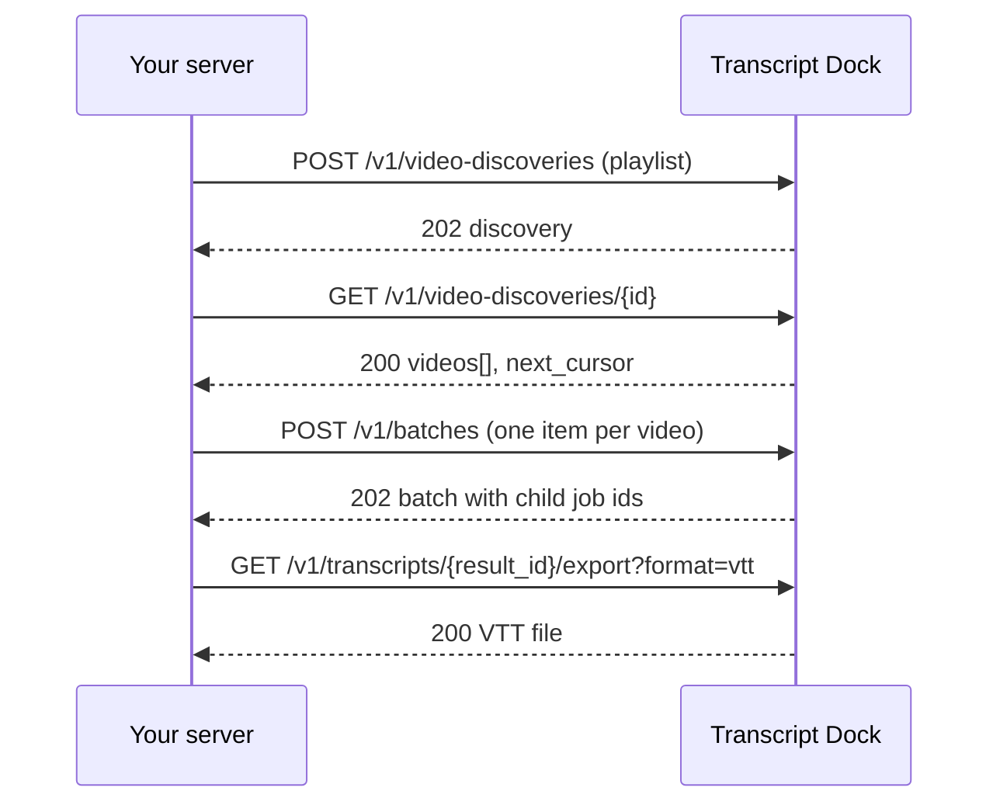

<p align="center">
  <a href="https://www.transcriptdock.com/platforms/youtube"></a>
</p>

<h1 align="center">YouTube Transcript API</h1>

<p align="center">
  <strong>YouTube transcripts through one API: creator captions, automatic captions and AI transcription, with search, channel and playlist discovery.</strong>
</p>

<p align="center">
  <a href="https://www.transcriptdock.com/platforms/youtube">Website</a> •
  <a href="https://www.transcriptdock.com/docs/api-reference">API docs</a> •
  <a href="https://www.transcriptdock.com/pricing">Pricing</a> •
  <a href="#quick-start">Quick start</a> •
  <a href="#examples">Examples</a> •
  <a href="./skills/youtube-transcript-api/SKILL.md">Agent skill</a>
</p>

<p align="center">
  <a href="https://www.transcriptdock.com/docs/api-reference"></a>
  <a href="https://www.transcriptdock.com/docs/openapi.yaml"></a>
  <a href="https://www.transcriptdock.com/pricing"></a>
  <a href="https://www.transcriptdock.com/platforms/youtube"></a>
  <a href="https://www.transcriptdock.com/docs/mcp"></a>
  <a href="https://pypi.org/project/transcriptdock/"></a>
  <a href="./LICENSE"></a>
</p>

---

This repo is the YouTube guide to the [Transcript Dock API](https://github.com/TranscriptDock/transcriptdock-api). The same API also covers TikTok, Instagram and your own files.

## Why use it for YouTube

- **Captions the way you want them.** Choose creator captions, YouTube's automatic captions or either, and list the languages you prefer in order.
- **Know the languages before you pay.** A language discovery lists every caption track on a video, with its code and whether the creator uploaded it.
- **No captions is not a dead end.** `auto` falls back to AI transcription when a video has no captions, with word timing and a spend cap.
- **Find the videos first.** Search YouTube, list a channel, search within a channel or page through a playlist, then submit the links as a batch.
- **Every link format.** `watch?v=`, `youtu.be/`, `/shorts/` and `/live/` links all work.
- **Exports included.** TXT, JSON, SRT and VTT, as often as you like, for free.
- **Safe to automate.** Idempotency keys on every create and `max_credits` on every AI job.

What it does not do: no translation, and no private, members only or age gated videos.

## How it works



1. **Submit** a video with `POST /v1/jobs`, or many with `POST /v1/batches`.
2. **Wait** with `GET /v1/jobs/{id}?wait=25`, which returns as soon as the job is final, or receive a [webhook](#webhooks).
3. **Read or export** with `GET /v1/transcripts/{result_id}` or `/export?format=txt|json|srt|vtt`.

### Modes for YouTube

| Mode | What it does | Cost |
|---|---|---|
| `captions_only` | Creator or automatic captions. Never starts AI transcription. Fails with `NO_CAPTIONS` when the video has none. | 1 credit per successful transcript |
| `auto` | Captions when they exist, AI transcription when they do not. Paid plans. | 1 credit with captions, otherwise 2 credits per started minute |
| `transcribe` | AI transcription of the audio, with word timing. Paid plans. | 2 credits per started minute, 60 second minimum |

### Choosing a caption track

| Field | Values | Effect |
|---|---|---|
| `caption_preference` | `prefer_creator` (default), `creator_only`, `automatic_only` | Creator captions first, creator captions only, or YouTube's automatic captions only |
| `caption_languages` | Up to 5 BCP 47 codes in order, for example `["es", "en"]` | The first listed language the video has wins. Empty means the video's default track. |

If none of `caption_languages` exists on the video, the job fails with `LANGUAGE_UNAVAILABLE`. In `captions_only` mode, a `creator_only` miss fails. In `auto` mode it falls back to AI transcription. `language` is a different field: a spoken language hint for AI transcription, not a translation target.

## Endpoints

| Method | Path | What it does | Credits |
|---|---|---|---|
| `POST` | `/v1/jobs` | Transcribe one YouTube video | 1 per caption transcript, 2 per minute of AI transcription |
| `GET` | `/v1/jobs/{id}?wait=25` | Job status, long poll | Free |
| `POST` | `/v1/batches` | Many videos in one atomic request | Per item |
| `GET` | `/v1/batches/{id}` | Batch status and child jobs | Free |
| `GET` | `/v1/transcripts/{id}` | Transcript JSON | Free |
| `GET` | `/v1/transcripts/{id}/export` | `txt`, `json`, `srt` or `vtt` | Free |
| `POST` | `/v1/language-discoveries` | Caption tracks of one video | 1 |
| `GET` | `/v1/language-discoveries/{id}` | Language list | Free |
| `POST` | `/v1/video-discoveries` | `youtube_search`, `youtube_channel_videos`, `youtube_channel_search`, `youtube_playlist_videos` | 1 per page |
| `GET` | `/v1/video-discoveries/{id}` | Videos and `next_cursor` | Free |
| `GET` | `/v1/capabilities` | What your key can do | Free |
| `GET` | `/v1/usage` | Plan and credit balance | Free |

### Video discovery kinds

| Kind | Required field | Example |
|---|---|---|
| `youtube_search` | `query` | `{"kind":"youtube_search","query":"async rust","limit":5}` |
| `youtube_channel_videos` | `channel` (`@handle`, channel id or URL) | `{"kind":"youtube_channel_videos","channel":"@veritasium","limit":10}` |
| `youtube_channel_search` | `channel` and `query` | `{"kind":"youtube_channel_search","channel":"@veritasium","query":"black holes"}` |
| `youtube_playlist_videos` | `playlist` (id or URL) | `{"kind":"youtube_playlist_videos","playlist":"PL...","limit":20}` |

`limit` is 1 to 50 (default 20). Pass the result's `next_cursor` back as `cursor` for the next page. Each page costs 1 credit, and results are kept for 24 hours. Pages can overlap slightly when a limit cuts a page short.

Full schemas: [API reference](https://www.transcriptdock.com/docs/api-reference), [OpenAPI 3.1](https://www.transcriptdock.com/docs/openapi.yaml) and the compact [docs/README.md](./docs/README.md).

## Credit costs

| What | Credits |
|---|---|
| Caption transcript (YouTube, TikTok) | 1 per successful transcript |
| AI transcription (any source) | 2 per started minute, 60 second minimum |
| Video discovery (YouTube search, channel, playlist, TikTok profile) | 1 per page |
| Caption language discovery (YouTube) | 1 |
| Failed job | 0 |
| Polling, transcript reads and exports | 0 |
| Idempotent replay (same key, same body) | 0 |
| Same video and options already transcribed in your workspace | 0 (`billing.kind: "cached"`) |

While a job runs, its maximum cost is held (`billing.credits_reserved`). When it finishes, only the real cost is charged (`billing.credits_charged`) and the rest is released.

### Worked examples

| Job | Credits |
|---|---|
| A video with creator captions, `captions_only` | 1 |
| A video with no captions, `captions_only` | 0 (fails with `NO_CAPTIONS`) |
| Language discovery, then captions in Spanish | 1 + 1 = 2 |
| A 45 second Short with no captions, `auto` | 2 (the 60 second minimum) |
| A 12 minute video with no captions, `auto` | 24 |
| A 2 hour live stream replay, `transcribe` | 240 |
| One playlist page of 25 videos, then a batch of their captions | 1 + 25 = 26 |
| Asking again for a video your workspace already transcribed with the same options | 0 (`billing.kind: "cached"`) |

## Plans

One credit balance covers captions, AI transcription and discovery.

| | Free | Starter | Pro | Scale |
|---|---|---|---|---|
| Price | $0, no card | $19 a month or $190 a year | $49 a month or $490 a year | $149 a month or $1,490 a year |
| Credits | 50 every 30 days | 2,000 a month | 6,000 a month | 20,000 a month |
| Extra credits | Not available | $8 per 1,000 | $7 per 1,000 | $6 per 1,000 |
| Sources | YouTube and TikTok captions | YouTube, TikTok, Instagram, uploads, direct links | YouTube, TikTok, Instagram, uploads, direct links | YouTube, TikTok, Instagram, uploads, direct links |
| AI transcription | Not included | 2 credits a minute | 2 credits a minute | 2 credits a minute |
| Batch size | 1 link | 10 links | 25 links | 50 links |
| Submits a minute | 10 | 60 | 120 | 300 |
| Jobs in progress | 10 | 100 | 500 | 2,000 |
| Retention | 7 days | 30 days | 90 days | 90 days |

Yearly billing gives 2 months free. Yearly plans still get their credits every month, and unused monthly credits do not roll over. Purchased credits never expire. Reads (job polling, transcripts, exports) have a separate limit of 120 a minute on every plan. Prices and limits can change: [transcriptdock.com/pricing](https://www.transcriptdock.com/pricing) is the source of truth.

## Quick start

1. [Create a free account](https://www.transcriptdock.com/signup). The free plan includes 50 caption credits every 30 days.
2. Create an API key in the [dashboard](https://www.transcriptdock.com/dashboard) and keep it on your server:

```bash
export TRANSCRIPTDOCK_API_KEY="td_live_..."
```

### cURL

```bash
# Spanish captions if the video has them, English otherwise. At most 1 credit.
curl -sS -X POST https://www.transcriptdock.com/v1/jobs \
  -H "Authorization: Bearer $TRANSCRIPTDOCK_API_KEY" \
  -H "Idempotency-Key: $(uuidgen)" \
  -H "Content-Type: application/json" \
  -d '{
    "source": {"url": "https://www.youtube.com/watch?v=dQw4w9WgXcQ"},
    "mode": "captions_only",
    "caption_languages": ["es", "en"],
    "caption_preference": "prefer_creator",
    "max_credits": 1
  }'

# Wait for the job, up to 25 seconds per call
curl -sS "https://www.transcriptdock.com/v1/jobs/JOB_ID?wait=25" \
  -H "Authorization: Bearer $TRANSCRIPTDOCK_API_KEY"

# Export as WebVTT
curl -sS "https://www.transcriptdock.com/v1/transcripts/RESULT_ID/export?format=vtt" \
  -H "Authorization: Bearer $TRANSCRIPTDOCK_API_KEY"
```

### JavaScript (Node 18+, no dependencies)

```js
import { randomUUID } from "node:crypto";

const API = "https://www.transcriptdock.com";
const auth = { Authorization: `Bearer ${process.env.TRANSCRIPTDOCK_API_KEY}` };

async function call(method, path, body, idempotencyKey) {
  const res = await fetch(API + path, {
    method,
    redirect: "error",
    headers: {
      ...auth,
      ...(body && { "Content-Type": "application/json" }),
      ...(idempotencyKey && { "Idempotency-Key": idempotencyKey }),
    },
    body: body && JSON.stringify(body),
  });
  if (!res.ok) throw new Error(`${res.status} ${await res.text()}`);
  return res.json();
}

let job = await call("POST", "/v1/jobs", {
  source: { url: "https://www.youtube.com/watch?v=dQw4w9WgXcQ" },
  mode: "captions_only",
  caption_languages: ["en"],
  caption_preference: "prefer_creator",
  max_credits: 1,
}, randomUUID());

while (!["succeeded", "failed", "cancelled"].includes(job.status)) {
  job = await call("GET", `/v1/jobs/${job.id}?wait=25`);
}

if (job.status !== "succeeded") throw new Error(`${job.status}: ${job.error?.code}`);
const transcript = await call("GET", `/v1/transcripts/${job.result_id}`);
for (const s of transcript.segments.slice(0, 5)) console.log(`[${s.start.toFixed(1)}s] ${s.text}`);
```

### Python (`pip install transcriptdock`)

```python
import os
from uuid import uuid4
from transcriptdock import TranscriptDock, JobTimeoutError

client = TranscriptDock(os.environ["TRANSCRIPTDOCK_API_KEY"])

# Generate once per intended operation. Save this key and the returned job ID.
submission_key = str(uuid4())
job = client.create_job(
    {"source": {"url": "https://www.youtube.com/watch?v=dQw4w9WgXcQ"},
     "mode": "captions_only", "caption_languages": ["en"], "max_credits": 1},
    idempotency_key=submission_key,
)
try:
    job = client.wait_for_job(job["id"], timeout=120)
except JobTimeoutError as error:
    print("Still running", error.job)
else:
    if job["status"] == "succeeded":
        print(client.export_transcript(job["result_id"], "vtt"))
    else:
        print(job["status"], job.get("error"))
```

## What you get back

Example data. A caption transcript from `GET /v1/transcripts/{result_id}`:

```json
{
  "id": "22222222-2222-4222-8222-222222222222",
  "source": {
    "platform": "youtube",
    "media_id": "aBcDeFgHiJk",
    "canonical_url": "https://www.youtube.com/watch?v=aBcDeFgHiJk",
    "title": "Example video"
  },
  "source_origin": "platform_captions",
  "language": "en",
  "text": "In this video we look at three ways to store a sourdough starter.",
  "segments": [
    { "start": 0.0, "end": 3.2, "text": "In this video we look at" },
    { "start": 3.2, "end": 6.0, "text": "three ways to store a sourdough starter." }
  ],
  "words": null,
  "timing_granularity": "segment",
  "duration_seconds": null,
  "recognition": null,
  "extraction_version": "worker-0.1.0",
  "created_at": "2026-11-18T10:00:14.000Z"
}
```

`source_origin` is `creator_captions` for captions the creator uploaded, `platform_captions` for YouTube's automatic captions and `speech_recognition` for AI transcription. Times are in seconds. `duration_seconds` can be null for caption sources that do not report it.

A finished language discovery (example data, trimmed):

```json
{
  "id": "77777777-7777-4777-8777-777777777777",
  "status": "succeeded",
  "source": { "platform": "youtube", "media_id": "aBcDeFgHiJk", "canonical_url": "https://www.youtube.com/watch?v=aBcDeFgHiJk" },
  "languages": [
    { "code": "en", "display_name": "English", "native_name": "English", "origin": "creator", "is_original": true, "is_default": true, "timed_text": true },
    { "code": "es", "display_name": "Spanish", "native_name": "Español", "origin": "automatic", "is_original": false, "is_default": false, "timed_text": true }
  ],
  "default_language": "en",
  "original_language": "en",
  "error": null,
  "created_at": "2026-11-18T10:00:00.000Z",
  "updated_at": "2026-11-18T10:00:02.000Z",
  "expires_at": "2026-11-19T10:00:00.000Z"
}
```

## Webhooks

Polling with `?wait=25` is fine for scripts. For pipelines, register a webhook and let Transcript Dock call you.

1. Register an `https` URL on the Webhooks page of the [dashboard](https://www.transcriptdock.com/dashboard). Registering and disabling endpoints needs a signed in session. An API key can list endpoints but gets `403 FORBIDDEN` when it tries to create one. The signing secret is shown once: store it like a password.
2. Pass the endpoint id as `webhook_endpoint_id` when you create a job or a batch.
3. Transcript Dock sends `job.succeeded`, `job.failed` or `batch.completed` when the work is final.

```json
{
  "event_id": "44444444-4444-4444-8444-444444444444",
  "type": "job.succeeded",
  "created_at": "2026-11-18T10:00:14.000Z",
  "job_id": "11111111-1111-4111-8111-111111111111",
  "batch_id": null,
  "result_id": "22222222-2222-4222-8222-222222222222",
  "metadata": { "order": "8812" },
  "error": null
}
```

The event does not carry the transcript text. Fetch or export `result_id` when you receive it.

**Verify every delivery.** Each request has three headers: `X-TranscriptDock-Event-Id`, `X-TranscriptDock-Timestamp` and `X-TranscriptDock-Signature`. The signature is a hex HMAC SHA256 of `{event_id}.{timestamp}.{raw_body}` keyed with your endpoint secret.

- Compute it over the raw request body, before any JSON parsing.
- Compare in constant time.
- Reject timestamps more than five minutes away from your clock.
- Answer with any 2xx within a few seconds, and do the slow work afterwards. Redirects are not followed.
- Failed deliveries are retried with backoff, and an event can arrive more than once. Deduplicate on `event_id`.

```js
import { createHmac, timingSafeEqual } from "node:crypto";

export function verifyTranscriptDock(eventId, timestamp, rawBody, signature, secret) {
  if (Math.abs(Date.now() / 1000 - Number(timestamp)) > 300) return false;
  const expected = createHmac("sha256", secret)
    .update(`${eventId}.${timestamp}.`)
    .update(rawBody) // the exact bytes you received
    .digest("hex");
  return expected.length === String(signature).length &&
    timingSafeEqual(Buffer.from(expected), Buffer.from(String(signature)));
}
```

The full contract, including retries and payload fields, is in the [webhook docs](https://www.transcriptdock.com/docs/api-reference#webhooks).

## Errors

Every error has the same envelope. Quote `request_id` (also sent as the `X-Request-Id` header) when you contact support.

```json
{
  "error": {
    "code": "INSUFFICIENT_BALANCE",
    "message": "Not enough credits. Buy credits or upgrade your plan to continue.",
    "retryable": false,
    "details": { "detail": "This job needs more credits than you have left." },
    "doc_url": "https://www.transcriptdock.com/docs/api-reference#error-codes"
  },
  "request_id": "66666666-6666-4666-8666-666666666666"
}
```

A job that fails after it was accepted still returns HTTP 200 on `GET /v1/jobs/{id}`, with `status: "failed"` and the same error object in `error`. Failed jobs cost nothing.

| Code | HTTP | Retry | What to do |
|---|---|---|---|
| `INVALID_REQUEST` | 422 | No | A field is missing or malformed. `details.detail` names it. |
| `INVALID_URL` / `UNSUPPORTED_SOURCE` | 422 | No | Send a supported https link. |
| `CAPABILITY_UNAVAILABLE` | 422 | No | That mode is not available for this source. Check `GET /v1/capabilities`. |
| `UNAUTHENTICATED` | 401 | No | Missing or invalid API key. |
| `FORBIDDEN` | 403 | No | The key lacks the scope for this endpoint. |
| `INSUFFICIENT_BALANCE` | 402 | No | Buy credits or upgrade. |
| `PLAN_REQUIRED` | 402 | No | AI transcription, Instagram, uploads and larger batches need a paid plan. |
| `BUDGET_EXCEEDED` | 402 | No | The measured cost is above `max_credits`. Nothing was charged. Raise the cap or skip the media. |
| `IDEMPOTENCY_CONFLICT` | 409 | No | The key was used with a different body. Use a new key. |
| `JOB_NOT_RETRYABLE` | 409 | No | The failure was final. Fix the input and submit a new job. |
| `RATE_LIMITED` | 429 | Yes | Wait `Retry-After` seconds, then resend with the same idempotency key. |
| `NO_CAPTIONS` | 422 | No | The video has no captions and the mode was `captions_only`. Use `auto` or `transcribe`. |
| `LANGUAGE_UNAVAILABLE` | 422 | No | None of `caption_languages` exists on the video. Drop the list to take the default track. |
| `SOURCE_NOT_FOUND` / `SOURCE_PRIVATE` / `SOURCE_AUTH_REQUIRED` / `SOURCE_REGION_RESTRICTED` | 422 | No | Only public, reachable media works. |
| `DURATION_LIMIT_EXCEEDED` / `FILE_TOO_LARGE` | 413 | No | Media over 2 hours or 250 MB. |
| `TIMESTAMPS_UNAVAILABLE` | 422 | No | No timing for SRT or VTT. Export `txt` or `json`. |
| `SOURCE_RATE_LIMITED` / `SOURCE_BLOCKED` / `SOURCE_TIMEOUT` | 503 | Yes | The platform is throttling. The job retries automatically. |
| `INTERNAL_ERROR` | 500 | Yes | Retry with the same idempotency key. Report the request id if it persists. |

The [full error list](https://www.transcriptdock.com/docs/api-reference#error-codes) has every code.

## Idempotency and spend caps

Two habits make the API safe to call from scripts, queues and agents.

**Send an `Idempotency-Key` on every create.** It is required on `POST /v1/jobs`, `/v1/batches`, `/v1/video-discoveries`, `/v1/language-discoveries` and `/v1/jobs/{id}/retry`. Use 8 to 128 printable ASCII characters.

- Same key and same body: you get the original object back. Nothing is created or charged twice.
- Same key and a different body: `409 IDEMPOTENCY_CONFLICT`.
- Generate the key once per intended operation and save it with your record. If a response is lost, resend the same body with the same key. Never resubmit blindly with a fresh key.
- A good key is your own id for the thing you are transcribing, for example `yt-dQw4w9WgXcQ-captions`.
- A retry (`POST /v1/jobs/{id}/retry`) needs a new key, because it is a new job.

**Set `max_credits` on AI transcription.** The media is measured first. If the cost would be above your cap, the job fails with `BUDGET_EXCEEDED` and nothing is charged. Without a cap the default covers the 2 hour maximum (240 credits).

| Longest media you accept | `max_credits` |
|---|---|
| 1 minute | 2 |
| 5 minutes | 10 |
| 10 minutes | 20 |
| 30 minutes | 60 |
| 2 hours | 240 |

`max_credits` is ignored for `captions_only`, which always costs 1 credit. The examples in this repo still send it, so a later switch to `auto` keeps a cap.

## Examples

Every example reads `TRANSCRIPTDOCK_API_KEY`, sends an idempotency key and caps `max_credits`. They spend real credits, so read the comment at the top of each file first.

| Example | What it shows |
|---|---|
| [curl/examples.sh](./examples/curl/examples.sh) | Captions with language preferences, language discovery, search, channel and playlist listings, batches, `auto` with a cap |
| [javascript/captions.mjs](./examples/javascript/captions.mjs) | Captions in your preferred languages, printed with timestamps, exported as VTT |
| [javascript/languages.mjs](./examples/javascript/languages.mjs) | List a video's caption tracks, then fetch one |
| [javascript/playlist-to-batch.mjs](./examples/javascript/playlist-to-batch.mjs) | Playlist discovery, then a batch of caption jobs |
| [javascript/auto-fallback.mjs](./examples/javascript/auto-fallback.mjs) | `auto` mode with a `max_credits` cap for videos without captions |
| [python/captions.py](./examples/python/captions.py) | Captions with `caption_languages` and `caption_preference` |
| [python/languages.py](./examples/python/languages.py) | Language discovery with the Python SDK |
| [python/playlist_batch.py](./examples/python/playlist_batch.py) | Playlist discovery, batch, then each transcript as text |
| [python/search_and_transcribe.py](./examples/python/search_and_transcribe.py) | Search YouTube and transcribe the top result |

```bash
node examples/javascript/playlist-to-batch.mjs "https://www.youtube.com/playlist?list=PLAYLIST_ID" 5
python examples/python/languages.py "https://www.youtube.com/watch?v=dQw4w9WgXcQ"
bash examples/curl/examples.sh help
```

## SDKs

Plain HTTP works everywhere, and every example in this repo uses either `fetch` or the Python SDK. Typed clients:

| Language | Package | Status |
|---|---|---|
| Python | [`transcriptdock`](https://pypi.org/project/transcriptdock/) on PyPI ([source](https://github.com/TranscriptDock/transcriptdock-python)) | Published |
| Go | [`github.com/TranscriptDock/transcriptdock-go`](https://github.com/TranscriptDock/transcriptdock-go) | Published |
| Ruby | `transcriptdock` gem ([source](https://github.com/TranscriptDock/transcriptdock-ruby)) | Published |
| PHP | `transcriptdock/transcriptdock` on Packagist ([source](https://github.com/TranscriptDock/transcriptdock-php)) | Published |
| .NET | `TranscriptDock` on NuGet ([source](https://github.com/TranscriptDock/transcriptdock-dotnet)) | Published |
| JavaScript and TypeScript | [`transcriptdock`](https://www.npmjs.com/package/transcriptdock) on npm ([source](https://github.com/TranscriptDock/transcriptdock-js)) | Published |
| Dart and Flutter | [`transcriptdock`](https://pub.dev/packages/transcriptdock) on pub.dev ([source](https://github.com/TranscriptDock/transcriptdock-dart)) | Published |
| Java | `com.transcriptdock:transcriptdock` ([source](https://github.com/TranscriptDock/transcriptdock-java)) | Coming soon |
| Rust | `transcriptdock` on crates.io ([source](https://github.com/TranscriptDock/transcriptdock-rust)) | Coming soon |
| Swift | Swift Package Manager, `from: "0.1.0"` ([source](https://github.com/TranscriptDock/transcriptdock-swift)) | Published |

Generating your own client? Start from the [OpenAPI 3.1 spec](https://www.transcriptdock.com/docs/openapi.yaml) ([repo](https://github.com/TranscriptDock/transcriptdock-openapi)). No code at all: the [n8n node](https://github.com/TranscriptDock/n8n-nodes-transcriptdock) (`n8n-nodes-transcriptdock`) and the [Apify Actor](https://github.com/TranscriptDock/transcriptdock-apify).

## MCP and AI agents

### Hosted MCP server

Transcript Dock runs a hosted MCP server at `https://www.transcriptdock.com/mcp` (Streamable HTTP). It signs you in with OAuth, or accepts an API key as a bearer header. Use the `www` URL exactly: the apex domain redirects, and clients drop the `Authorization` header on a cross origin redirect.

```bash
claude mcp add --transport http transcriptdock https://www.transcriptdock.com/mcp
```

Then run `/mcp` in Claude Code and choose Authenticate. In the Claude apps, add `https://www.transcriptdock.com/mcp` as a custom connector. Cursor, Windsurf and other clients are covered in the [MCP docs](https://www.transcriptdock.com/docs/mcp). A local stdio server is on npm as `@transcriptdock/mcp` ([source](https://github.com/TranscriptDock/transcriptdock-mcp)).

The MCP tools include `get_video_transcript` (submit, wait and return text in one call), `transcribe`, `get_job`, `get_transcript`, `wait_for_job`, `search_youtube`, `list_channel_videos`, `list_playlist_videos` and `list_tiktok_user_videos`.

### Agent skill in this repo

[`skills/youtube-transcript-api/SKILL.md`](./skills/youtube-transcript-api/SKILL.md) teaches an agent to use the HTTP API safely: check capabilities, submit with an idempotency key and a `max_credits` cap, wait, export, ask before paid AI transcription, and never invent timestamps.

```bash
# Claude Code: install for every project
mkdir -p ~/.claude/skills
cp -r skills/youtube-transcript-api ~/.claude/skills/

# or for one project
mkdir -p .claude/skills
cp -r skills/youtube-transcript-api .claude/skills/
```

The skill reads your key from `TRANSCRIPTDOCK_API_KEY`. Never paste a key into a chat.

## FAQ

<details>
<summary><strong>Does it return YouTube's automatic captions?</strong></summary>

Yes. The default `prefer_creator` takes creator captions when they exist and automatic captions otherwise. `automatic_only` and `creator_only` force one kind. The transcript's `source_origin` says which one you got.
</details>

<details>
<summary><strong>Do Shorts and live stream links work?</strong></summary>

Yes: `youtube.com/shorts/` and `youtube.com/live/` links are accepted, as are `watch?v=` and `youtu.be/` links. Media can be up to 2 hours long.
</details>

<details>
<summary><strong>What if a video has no captions?</strong></summary>

`captions_only` fails with `NO_CAPTIONS` and costs nothing. Resubmit with `auto` or `transcribe` on a paid plan for AI transcription at 2 credits per started minute, and set `max_credits`.
</details>

<details>
<summary><strong>Can I get a transcript in another language?</strong></summary>

Only if the video has a caption track in that language. Run a language discovery (1 credit) to see the tracks, then list your choices in `caption_languages`. There is no machine translation.
</details>

<details>
<summary><strong>How do I get every video in a playlist or channel?</strong></summary>

Create a video discovery with `youtube_playlist_videos` or `youtube_channel_videos`, up to 50 videos a page. Follow `next_cursor` for more pages, 1 credit each. Then submit the URLs as a batch: up to 10, 25 or 50 items per batch on Starter, Pro and Scale.
</details>

<details>
<summary><strong>Do I pay twice for the same video?</strong></summary>

Not inside one workspace. If you already hold a transcript for the same video and options, the job returns at once with `billing.kind: "cached"` and costs nothing. Exports are always free.
</details>

<details>
<summary><strong>Are private or members only videos supported?</strong></summary>

No. Only public videos work. Private, members only and age gated videos fail with a `SOURCE_*` error code.
</details>

## More Transcript Dock repos

| Repo | Focus |
|---|---|
| [transcriptdock-api](https://github.com/TranscriptDock/transcriptdock-api) | The hub: every source, every endpoint, uploads and webhooks |
| [tiktok-transcript-api](https://github.com/TranscriptDock/tiktok-transcript-api) | TikTok captions, AI fallback, profile video discovery, batches |
| [instagram-transcript-api](https://github.com/TranscriptDock/instagram-transcript-api) | AI transcription for public Instagram Reels and video posts |

## Chrome extension

Want transcripts without writing code? The [Transcript Dock extension for Chrome](https://chromewebstore.google.com/detail/bepajpcnjahahnkjkfeojmpbddakoodg) shows transcripts beside YouTube, TikTok and Instagram videos. More at [transcriptdock.com/extension](https://www.transcriptdock.com/extension).

---

## Issues and feedback

This repo holds examples, docs and an agent skill for the hosted Transcript Dock API.

- Found a bug in an example, or the API behaving differently from the docs? [Open an issue](../../issues/new/choose) and include the `X-Request-Id`.
- Have an idea for a feature or a new example? Open a feature request.
- Security issue? Email [transcriptdock@volods.com](mailto:transcriptdock@volods.com) instead of opening an issue.

See [CONTRIBUTING.md](./CONTRIBUTING.md) before sending a pull request.

## Links

- Website: [transcriptdock.com](https://www.transcriptdock.com)
- Docs: [quickstart](https://www.transcriptdock.com/docs/quickstart), [API reference](https://www.transcriptdock.com/docs/api-reference), [sources](https://www.transcriptdock.com/docs/platforms)
- OpenAPI spec: [openapi.yaml](https://www.transcriptdock.com/docs/openapi.yaml)
- Pricing: [transcriptdock.com/pricing](https://www.transcriptdock.com/pricing)
- Changelog: [docs/changelog](https://www.transcriptdock.com/docs/changelog)
- Contact: [transcriptdock@volods.com](mailto:transcriptdock@volods.com)

## License

The examples, docs and skill in this repository are released under the [MIT License](./LICENSE).

The Transcript Dock API is a hosted service covered by its [Terms of Service](https://www.transcriptdock.com/docs/terms).
